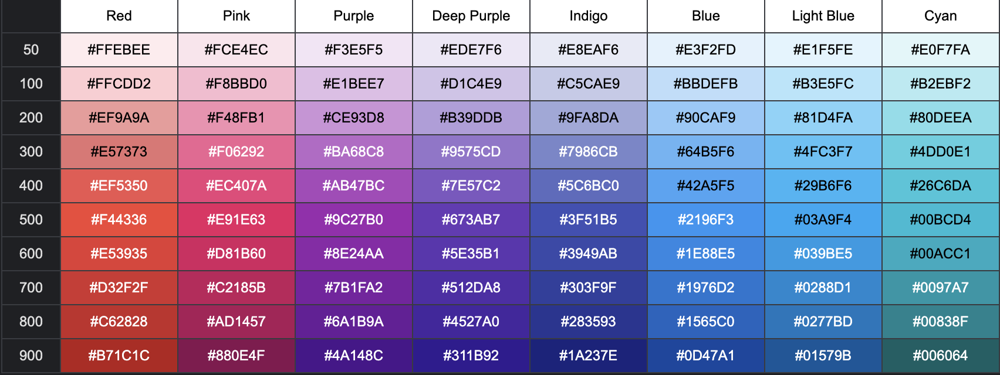

# Material Design Colors by Google

Material color tokens and Material 3 style color schemes for multiple platforms.

> Repository layout: one token source, platform package folders for iOS, React Native, and Python.
> Android is intentionally not packaged; use official Jetpack Compose Material 3 `ColorScheme` APIs on Android.


---

This project keeps the original Material Design 2 palette constants such as `pink400` and `tealA700`, and adds Material 3 role-based color schemes modeled after Compose Material 3:

```text
MaterialTheme
  colorScheme
    primary
    onPrimary
    primaryContainer
    surface
    onSurface
    surfaceContainerHighest
    error
    outline
```

For the meaning and usage of each Material 3 color role, see the official [Material Design 3 color roles](https://m3.material.io/styles/color/roles) guide.

Android apps should use the official Compose Material 3 APIs directly, including `dynamicLightColorScheme()`, `dynamicDarkColorScheme()`, and `MaterialTheme.colorScheme`: [Android Developers - Material 3 in Compose](https://developer.android.com/develop/ui/compose/designsystems/material3?hl=ko#dynamic_color_schemes).

The default light/dark Material 3 schemes in this repository are the `tonalSpot` preset generated from source color `#6750A4` with Google Material Color Utilities: [material-foundation/material-color-utilities](https://github.com/material-foundation/material-color-utilities).

Official Material 3 dynamic scheme variants are also provided as fixed presets:

```text
tonalSpot
fidelity
content
monochrome
neutral
vibrant
expressive
rainbow
fruitSalad
```

## Material 3 Color Roles

Google defines color roles by their purpose in the UI. A role keeps its meaning when the theme changes, while its color value can change. Choose roles for the component's state and emphasis rather than hard-coding a palette shade.

### Main color groups

| Group | Purpose | Fill / content pair | Container / content pair |
| --- | --- | --- | --- |
| Primary | Prominent actions and active states | `primary` / `onPrimary` | `primaryContainer` / `onPrimaryContainer` |
| Secondary | Less prominent supporting elements | `secondary` / `onSecondary` | `secondaryContainer` / `onSecondaryContainer` |
| Tertiary | Contrasting accents | `tertiary` / `onTertiary` | `tertiaryContainer` / `onTertiaryContainer` |
| Error | Errors and invalid input | `error` / `onError` | `errorContainer` / `onErrorContainer` |
| Surface | Backgrounds and large areas | `surface` / `onSurface` | Surface containers below / `onSurface` |
| Outline | Boundaries and separators | `outline` (important boundaries) | `outlineVariant` (subtle separators) |

An `on*` role colors text or icons on its matching fill: use `onPrimary` on `primary`, and `onPrimaryContainer` on `primaryContainer`. A container is a colored area holding content. These pairings support contrast; arbitrary custom hex overrides still require contrast checks.

Sources: [Google Material 3 color roles](https://m3.material.io/styles/color/roles) and [Android Developers: Material 3 color usage](https://developer.android.com/develop/ui/compose/designsystems/material3#color-usage).

### Surface, inverse, and fixed roles

| Roles | Purpose |
| --- | --- |
| `surfaceContainerLowest`, `surfaceContainerLow`, `surfaceContainer`, `surfaceContainerHigh`, `surfaceContainerHighest` | Increasing surface-container emphasis; these are not fixed elevation distances. |
| `surfaceDim`, `surfaceBright` | Dim and bright surface options. |
| `onSurfaceVariant` | Lower-emphasis surface content. |
| `inverseSurface`, `inverseOnSurface`, `inversePrimary` | Contrasting surfaces, their content, and accent color. |
| `surfaceTint` | Tint for components applying tonal elevation. |
| `scrim` | Overlay obscuring content behind a modal. |
| `primaryFixed`, `secondaryFixed`, `tertiaryFixed` | Container alternatives retaining their tone across light/dark themes. |
| `primaryFixedDim`, `secondaryFixedDim`, `tertiaryFixedDim` | Stronger fixed alternatives. |
| `onPrimaryFixed`, `onSecondaryFixed`, `onTertiaryFixed` | Content on corresponding fixed and fixed-dim fills. |
| `onPrimaryFixedVariant`, `onSecondaryFixedVariant`, `onTertiaryFixedVariant` | Lower-emphasis content on those fixed fills. |
| `background`, `onBackground`, `surfaceVariant` | Older background/content and surface roles retained by this package for compatibility. Prefer `surface`, `onSurface`, and `surfaceContainerHighest`, respectively, for new designs. |

Reference: [Google's Compose Material 3 ColorScheme API](https://developer.android.com/reference/kotlin/androidx/compose/material3/ColorScheme).

### Accessing roles in this repository

The tables above cover the **48 standard M3 roles provided by this repository**, defined in [`tokens/material3/color-scheme-roles.json`](tokens/material3/color-scheme-roles.json). This is the package's supported set, not a claim that every Material 3 API has exactly 48 roles. The 8 separate custom status roles are documented below.

| Platform | Example |
| --- | --- |
| SwiftUI | `theme.colorScheme.onPrimaryContainer.color` |
| UIKit | `theme.colorScheme.onPrimaryContainer.uiColor` |
| AppKit | `theme.colorScheme.onPrimaryContainer.nsColor` |
| JavaScript / TypeScript | `theme.colorScheme.onPrimaryContainer` |
| Python | `theme.color_scheme.on_primary_container.hex` |

Swift and JavaScript use camelCase properties; Python uses snake_case attributes, but its `create_theme(color_scheme=...)` override keys use camelCase. Baseline, preset, and custom schemes expose the same roles. This package supplies color values; apply the appropriate fill/content pair in your UI.

## API Documentation

Swift DocC API documentation for `MaterialDesignColorCore` is available at [docs.gorani.me/MaterialDesignColor/documentation/materialdesigncolorcore](https://docs.gorani.me/MaterialDesignColor/documentation/materialdesigncolorcore/).

## Installation

### Swift Package Manager

```swift
dependencies: [
  .package(url: "https://github.com/swift-man/MaterialDesignColor.git", from: "2.4.0")
]
```

Products:

| Product | Purpose |
| --- | --- |
| `MaterialDesignColor` | Backward-compatible SwiftUI product |
| `MaterialDesignColorCore` | Pure Swift palette and Material 3 theme model |
| `MaterialDesignColorSwiftUI` | `SwiftUI.Color` extensions and `Environment` theme support |
| `MaterialDesignColorUIKit` | `UIKit.UIColor` extensions |
| `MaterialDesignColorAppKit` | macOS `NSColor` conversion and adaptive colors |

## Usage

### iOS - SwiftUI

Material 2 palette constants remain available:

```swift
import SwiftUI
import MaterialDesignColor

Text("title")
  .foregroundStyle(Color.tealA700)
```

Material 3 color scheme roles are available through `MaterialTheme`:

```swift
import SwiftUI
import MaterialDesignColorSwiftUI

let theme = MaterialTheme.dark

Text("Hello")
  .foregroundStyle(theme.colorScheme.primary.color)
  .background(theme.colorScheme.surface.color)
```

Choose an official Material 3 preset when you want a different scheme variant:

```swift
let theme = MaterialTheme.preset(.expressive, appearance: .light)
let keyPrimary = MaterialThemePreset.expressive.keyColors.primary
```

Material Theme Builder role colors can be injected with type-safe role keys. Missing roles fall back to the selected preset.

```swift
let theme = try MaterialTheme.custom(
  appearance: .light,
  overrides: [
    .primary: "#6750A4",
    .onPrimary: "#FFFFFF",
    .primaryContainer: "#EADDFF",
    .onPrimaryContainer: "#21005D",
    .surface: "#FFFBFE",
    .onSurface: "#1C1B1F"
  ]
)
```

You can also place a theme in the SwiftUI environment:

```swift
struct ExampleView: View {
  @Environment(\.materialTheme) private var theme

  var body: some View {
    Text("Hello")
      .foregroundStyle(theme.colorScheme.onSurface.color)
      .background(theme.colorScheme.surface.color)
  }
}
```

### iOS - UIKit

```swift
import MaterialDesignColorUIKit

let scheme = MaterialColorScheme.baseline(.light)

label.textColor = scheme.onSurface.uiColor
button.backgroundColor = scheme.primary.uiColor
```

### JavaScript / TypeScript (React Native, Expo, web, Node)

The JS package is framework-agnostic — pure TypeScript compiled to ESM with no runtime dependencies. Works in React Native and Expo (Metro consumes the published `dist/` output), plain React, Vue, vanilla web, Node, Deno, and Bun. No native modules, no Expo config plugins, no prebuild required.

```bash
npm install @swift-man/material-design-color
# or: yarn add @swift-man/material-design-color
# or: pnpm add @swift-man/material-design-color
```

```ts
import { createMaterialTheme } from "@swift-man/material-design-color";

const theme = createMaterialTheme({ preset: "expressive", dark: false });

const color = theme.colorScheme.primary;
```

Inject Material Theme Builder role colors with `colorScheme`:

```ts
const theme = createMaterialTheme({
  colorScheme: {
    primary: "#6750A4",
    onPrimary: "#FFFFFF",
    primaryContainer: "#EADDFF",
    onPrimaryContainer: "#21005D",
    surface: "#FFFBFE",
    onSurface: "#1C1B1F",
  },
});
```

```tsx
import { createMaterialTheme } from "@swift-man/material-design-color";

const theme = createMaterialTheme({ dark: true });

export function Example() {
  return (
    <View style={{ backgroundColor: theme.colorScheme.surface }}>
      <Text style={{ color: theme.colorScheme.onSurface }}>Hello</Text>
    </View>
  );
}
```

Legacy palette constants are also available:

```ts
import { colors } from "@swift-man/material-design-color";

const backgroundColor = colors.pink400;
```

### Python

Python exposes the same Material 3 roles with Python-style field names.

```python
from material_design_color import create_theme

theme = create_theme(preset="expressive", dark=True)

primary = theme.color_scheme.primary.hex
surface = theme.color_scheme.surface.hex
on_surface = theme.color_scheme.on_surface.hex
```

Material Theme Builder role colors can be injected as camelCase role keys:

```python
theme = create_theme(
    color_scheme={
        "primary": "#6750A4",
        "onPrimary": "#FFFFFF",
        "primaryContainer": "#EADDFF",
        "onPrimaryContainer": "#21005D",
        "surface": "#FFFBFE",
        "onSurface": "#1C1B1F",
    }
)
```

Legacy palette constants are also available:

```python
from material_design_color import MaterialColors, colors

hex_value = colors.pink400
rgb = MaterialColors.BLUE_300.rgb
```

## Repository Layout

```text
MaterialDesignColor/
  Package.swift                         # Swift Package Manager entry point
  README.md
  LICENSE

  tokens/
    material-colors.json                # Material 2 legacy palette
    material3/
      color-scheme-roles.json           # Compose-style role names
      baseline-color-schemes.json       # Light/dark baseline schemes
      theme-presets.json                # Official M3 preset schemes and key colors
    schema.json

  packages/
    ios/
      Sources/
        MaterialDesignColorCore/
        MaterialDesignColorSwiftUI/
        MaterialDesignColorUIKit/
      Tests/

    js/
      package.json
      src/

    python/
      pyproject.toml
      src/material_design_color/
      tests/

  examples/
    ios-swiftui/
    ios-uikit/
    expo/
    python/

  tools/
    codegen/
```

All generated platform sources are produced from `tokens/`:

```bash
ruby tools/codegen/generate.rb
```

CI checks that generated files are up to date:

```bash
ruby tools/codegen/generate.rb --check
```

## Android

No Android artifact is published from this repository.

For Android, prefer official Jetpack Compose Material 3:

```kotlin
val colorScheme = if (darkTheme) {
  dynamicDarkColorScheme(context)
} else {
  dynamicLightColorScheme(context)
}

MaterialTheme(colorScheme = colorScheme) {
  // Use MaterialTheme.colorScheme.primary, surface, onSurface, ...
}
```

This keeps Android aligned with platform dynamic color behavior instead of shipping a parallel fixed-color package.

## Release Strategy

Recommended initial strategy: one repository tag for all non-Android packages.

```text
v2.4.0
```

Each package can publish its own artifact from that same tag:

| Platform | Folder | Registry |
| --- | --- | --- |
| iOS | root `Package.swift` + `packages/ios` | Swift Package Manager |
| JavaScript / TypeScript (RN, Expo, web, Node) | `packages/js` | npm |
| Python | `packages/python` | PyPI |

If platform release cycles become very different later, use platform-prefixed tags:

```text
ios-v2.4.0
js-v1.2.0
python-v1.0.0
```

## Material Palette Color Tool

* [COLOR TOOL](https://m2.material.io/resources/color/#!/?view.left=0&view.right=0)



## macOS SwiftUI and extended status colors (2.2)

Supports macOS 10.15+ (including macOS 14+) and iOS 13+; `foregroundStyle` in this example requires macOS 12+/iOS 15+. Add the `MaterialDesignColorSwiftUI` product to the app target.

```swift
import SwiftUI
import MaterialDesignColorSwiftUI

struct ContentView: View {
  @Environment(\.materialTheme) private var theme

  var body: some View {
    VStack {
      Text("안전")
        .foregroundStyle(theme.colorScheme.onSuccess.color)
        .padding().background(theme.colorScheme.success.color)
      Text("주의")
        .foregroundStyle(theme.colorScheme.onWarningContainer.color)
        .padding().background(theme.colorScheme.warningContainer.color)
    }
  }
}

// At the root, inside WindowGroup:
ContentView().materialTheme(preset: .tonalSpot)
// Or supply any custom light/dark pair:
ContentView().materialTheme(light: .light, dark: .dark)
```

The modifier reads SwiftUI's `colorScheme` environment and updates `materialTheme` when the system appearance (or an ancestor's color scheme override) changes. The existing `.materialTheme(theme)` still injects a fixed theme. Set the modifier above views that read `@Environment(\.materialTheme)`.

There are **48 standard M3 roles + 8 custom extended roles**. Standard role enumerations remain at 48 for compatibility. The extensions are not official M3 status roles. They use Google's MCU `customColor(..., blend: true)` (HCT harmonization) with success seed `#228B22`, warning seed `#FF9800`, and default theme source `#6750A4`. All built-in presets share that source, so they share the status colors. Light/dark values live in `tokens/material3/extended-color-schemes.json`.

| Custom fill | Matching content | Meaning |
| --- | --- | --- |
| `success` | `onSuccess` | Safe/successful operation |
| `successContainer` | `onSuccessContainer` | Low-emphasis success surface |
| `warning` | `onWarning` | Caution |
| `warningContainer` | `onWarningContainer` | Low-emphasis warning surface |

All four fill/content pairs are tested at WCAG contrast **≥ 4.5:1 in both modes**. This guarantee applies to the generated pairs, not arbitrary overrides or a status color used as text on an unrelated background. Do not rely on color alone: include text or an icon.

```swift
// Separate custom role enum; standard MaterialColorRole.allCases remains 48.
let scheme = try MaterialColorScheme.tonalSpotLight.overridingExtended([
  .success: "#006D37", .onSuccess: "#FFFFFF"
])
let customLight = MaterialTheme(colorScheme: scheme)
let status = scheme.extendedColors[.success] // also scheme.success
let defaults = MaterialExtendedColors.light // .dark is also available
let customStatus = try defaults.overriding([.warning: "#805600"])
```

### AppKit

Add the `MaterialDesignColorAppKit` product; it depends only on Core and AppKit.

```swift
import MaterialDesignColorAppKit

let native = MaterialTheme.light.colorScheme.success.nsColor
let explicit = NSColor(materialColor: MaterialTheme.dark.colorScheme.warning)
let adaptive = NSColor.materialBaseline(\.success)
```

### Generate a brand theme at build time

Seed generation is a **build-time tool**, not a Swift runtime `MaterialTheme.generated` API. It uses the official `@material/material-color-utilities` **0.4.0**, pinned in `tools/theme/package-lock.json`, at contrast level 0. It generates all 48 standard roles and harmonizes the 8 status roles against the supplied seed. Available variants: `tonalSpot`, `fidelity`, `content`, `monochrome`, `neutral`, `vibrant`, `expressive`, `rainbow`, `fruitSalad`.

From the repository root (Node 20+):

```bash
npm --prefix tools/theme ci
npm --prefix tools/theme run generate -- '#0A84FF' tonalSpot /absolute/path/to/GeneratedMaterialTheme.swift
# JSON for JS/Python or inspection:
npm --prefix tools/theme run generate -- '#0A84FF' tonalSpot /absolute/path/to/brand.json
npm --prefix tools/theme test
```

Add the generated Swift file to your app target, then use:

```swift
ContentView().materialTheme(light: GeneratedMaterialTheme.light,
                            dark: GeneratedMaterialTheme.dark)
```

The tool accepts only `#RRGGBB` seeds. Output paths are resolved from `tools/theme` when invoked through npm, so use absolute paths. No MCU dependency is added to the app or any platform runtime package. `tsx` handles the extensionless ESM imports in MCU 0.4.0. Checked-in snapshots cover all roles in both modes for `#6750A4`, `#0A84FF`, and `#FF0000` across all nine variants. The generated Swift fixture is compiled in macOS CI.

Reference: [Google Material Color Utilities](https://github.com/material-foundation/material-color-utilities/tree/main/typescript).


Maintainers: status seed definitions are in `tokens/material3/extended-color-schemes.json`.
After intentionally changing them, run `npm --prefix tools/theme run generate:extended`
and `ruby tools/codegen/generate.rb`. Review and refresh MCU snapshots when changing
seed definitions or the pinned MCU version; do not edit generated platform files.


## 템플릿 값과 앱 확정 값

**패키지는 롤 구조와 템플릿을 제공하고, 최종 제품 색은 앱이 확정합니다.**
패키지는 앱의 값을 주입하는 API와 대비 검증 도구를 제공합니다. 특정 제품의 브랜드·상태 색을 토큰에 추가하지 않습니다.
`success`/`warning` 기본값은 기본 seed `#6750A4`에 조화시킨 **템플릿**입니다.
제품에서는 앱이 의미·브랜드·접근성 기준에 따라 값을 확정해 덮어쓰는 것을 전제로 합니다.
값 기반 override는 앱 색상을 재조화하거나 변경하지 않습니다. 생략한 역할만 템플릿 기본값을 유지합니다.

| 경로 | 언제 사용하나 | 최종 값의 책임 |
| --- | --- | --- |
| 기본 프리셋 | 초기 화면, 프로토타입, 기본 역할 값을 출발점으로 사용 | 앱이 검토한 뒤 채택하거나 override |
| `tools/theme` 빌드 시 생성기 | 브랜드 seed에서 MCU 스킴 후보를 만들어 앱 소스로 보관 | 출력은 앱 프로젝트가 소유·검토하며 패키지 토큰에 편입하지 않음 |
| 런타임 `MaterialColor` override / `MaterialTheme.pair` | 앱 디자인 값, 사용자 설정, 시스템에서 얻은 색 주입 | 앱이 최종 값을 확정하고 실제 조합의 대비 검증 |

### Hex와 try 없이 앱 테마 구성 (2.3)

`MaterialColor(name:red:green:blue:)`는 **UInt8, 0…255 sRGB** 성분을 받습니다.
`MaterialColor(role:red:green:blue:)`는 표준 역할 이름으로 색상을 만듭니다.
두 생성자는 불투명 색상(alpha 255)을 만들고, 범위는 타입으로 제한합니다.
Display P3나 선형 RGB 값은 sRGB로 변환한 후 전달하세요. 시스템 강조색 변경도 앱이 관찰해 pair를 다시 만들어 주입합니다.

```swift
import MaterialDesignColorSwiftUI

// 설명용 값입니다. 실제 제품에서는 앱 디자인 값으로 교체합니다.
let appWarningLight = MaterialColor(name: "appWarningLight", red: 128, green: 64, blue: 0)
let appWarningDark = MaterialColor(name: "appWarningDark", red: 255, green: 192, blue: 128)
let appSuccessLight = MaterialColor(name: "appSuccessLight", red: 0, green: 96, blue: 48)
let appSuccessDark = MaterialColor(name: "appSuccessDark", red: 128, green: 224, blue: 160)
let white = MaterialColor(name: "white", red: 255, green: 255, blue: 255)
let black = MaterialColor(name: "black", red: 0, green: 0, blue: 0)
let appPrimary = MaterialColor(role: .primary, red: 32, green: 64, blue: 128)

let pair = MaterialTheme.pair(
  preset: .tonalSpot,
  light: [.primary: appPrimary],
  dark: [:],
  extendedLight: [.warning: appWarningLight, .onWarning: white,
                  .success: appSuccessLight, .onSuccess: white],
  extendedDark: [.warning: appWarningDark, .onWarning: black,
                 .success: appSuccessDark, .onSuccess: black]
)
// pair is an immutable MaterialThemePair with .light and .dark.
ContentView().materialTheme(light: pair.light, dark: pair.dark)
```

pair는 앱 값을 적용한 custom 테마입니다. `themePreset`은 nil이며 `sourceColor`는 출발 템플릿의 메타데이터일 뿐, 주입한 색을 재생성하지 않습니다.


확장 8개 역할을 모두 앱이 지정하려면 공개 생성자를 사용합니다. 모든 인수가 필수이므로 누락이 컴파일 시 드러납니다.

```swift
let status = MaterialExtendedColors(
  success: appSuccessLight, onSuccess: white,
  successContainer: appSuccessLight, onSuccessContainer: white,
  warning: appWarningLight, onWarning: white,
  warningContainer: appWarningLight, onWarningContainer: white
)
let changedStatus = status.overriding([.warning: appWarningDark])
let appStatusValues = Dictionary(uniqueKeysWithValues:
  MaterialExtendedColorRole.allCases.map { ($0, status[$0]) })
let scheme = MaterialColorScheme.custom(appearance: .light, overrides: [.primary: appPrimary])
  .overridingExtended(appStatusValues)
let changedScheme = scheme.overriding([.primary: appPrimary])
let oneTheme = MaterialTheme.custom(appearance: .light, overrides: [.primary: appPrimary])
```

기존 문자열 hex + `throws` 오버로드도 유지합니다. 타입 없는 빈 `[:]` 호출은 기존 hex API로 해석됩니다.
값 기반 빈 override를 단독 호출하려면 `[:] as [MaterialColorRole: MaterialColor]` 등으로 타입을 지정하세요.
모든 기본 역할을 요구하는 기존 `custom(appearance:roles:)`는 누락 검증을 유지합니다.
non-throwing `custom(base:appearance:overrides:)`는 명시적으로 프리셋을 출발점으로 사용합니다.

### 창별 SwiftUI 환경과 네이티브 동적 색상

`\.materialTheme`의 환경 기본값은 **`MaterialTheme.light`**입니다.
모디파이어를 붙이지 않은 장면은 시스템 다크 모드에 자동 반응하지 않습니다.
별도 창·설정 창 등 각 Scene의 루트에 `.materialTheme(light: pair.light, dark: pair.dark)`를 붙이세요.
모디파이어는 시스템 또는 조상 뷰의 `\.colorScheme`을 따라가며, `.materialTheme(theme)`는 고정 테마 주입입니다.

```swift
// AppKit: MaterialDesignColorAppKit 제품을 import
let nativeWarning = NSColor.material(light: pair.light, dark: pair.dark, \.warning)
// UIKit: MaterialDesignColorUIKit 제품을 import
let nativePrimary = UIColor.material(light: pair.light, dark: pair.dark, \.primary)
```

이 동적 색상은 주어진 두 테마의 값을 캡처합니다. 앱 색상 값 자체가 변경되면 다시 만드세요.
기존 `.materialBaseline(\.warning)`도 그대로 지원하며 기본 템플릿에 고정됩니다.

### 앱 테스트에서 최종 대비 검증

```swift
let ratio = appWarningLight.contrastRatio(with: white)
let issues = pair.light.colorScheme.contrastIssues(minimum: 4.5)
for issue in issues {
  print(issue.colorRole, issue.onRole, issue.ratio)
}
// 앱의 XCTest/Swift Testing에서 검사:
assert(pair.light.colorScheme.contrastIssues().isEmpty)
assert(pair.dark.colorScheme.contrastIssues().isEmpty)
```

`MaterialContrastIssue`는 camelCase `colorRole`, `onRole`, 반올림하지 않은 `ratio`를 제공합니다.
[WCAG 2.x의 sRGB 상대 휘도와 대비 공식](https://www.w3.org/TR/WCAG22/#dfn-contrast-ratio)을 사용합니다.
기본 `minimum`은 4.5이며 유한한 1…21 범위만 허용합니다(위반 시 precondition 실패).

검사에는 primary/secondary/tertiary/error의 기본·container 쌍, background/onBackground,
surface 및 모든 surface container/bright/dim과 onSurface, surfaceVariant/onSurfaceVariant,
inverseSurface/inverseOnSurface, fixed와 fixedDim 각각의 onFixed/onFixedVariant,
success/warning 기본·container 쌍이 포함됩니다(현재 35개 조합).
outline, scrim, surfaceTint 등 명시적 on 쌍이 없는 역할의 임의 배경 조합은 추론하지 않습니다.
실제 UI에서 인접한 다른 색은 `contrastRatio(with:)`로 직접 검사하세요.
opacity가 있는 최종 UI는 먼저 배경과 합성한 불투명 색을 비교해야 합니다.
4.5:1 충족은 앱의 실제 값·조합으로 판단하며 모든 프리셋 또는 임의 override에 대한 일괄 보장이 아닙니다.

### 기존 테마 재사용과 플랫폼별 대비 검증 (2.4.0)

앱이나 `tools/theme` 생성기로 이미 만든 두 테마도 하나의 값으로 묶을 수 있습니다.

```swift
let pair = MaterialThemePair(light: .light, dark: .dark)
// ContentView().materialTheme(light: pair.light, dark: pair.dark)
let expected = MaterialContrastIssue(colorRole: "warning", onRole: "onWarning", ratio: 1)
assert(!pair.light.colorScheme.contrastIssues().contains(expected))
do {
    let issues = try pair.light.colorScheme.validatedContrastIssues(minimum: 4.5)
    assert(issues.isEmpty)
} catch MaterialContrastError.invalidMinimum(let value) {
    print("잘못된 대비 기준: \(value)")
}
```

테마 쌍 생성자는 두 테마의 색·appearance 메타데이터를 바꾸지 않습니다. 앱이 각 표시 모드에
맞는 테마를 전달합니다. 진단 객체 생성자는 테스트 기대값 등 기록용이며 역할/비율을 검증하지 않습니다.
외부 설정에서 읽은 기준은 `validatedContrastIssues`로 검사하세요. 유한한 1...21 밖이면
오류를 던지며 기존 `contrastIssues`의 precondition 계약은 유지합니다.

```ts
import { createMaterialTheme, contrastRatio, contrastIssues } from '@swift-man/material-design-color';
const theme = createMaterialTheme({ colorScheme: { warning: '#804000', onWarning: '#FFFFFF' } });
console.log(contrastRatio('#804000', '#FFFFFF'));
console.log(contrastIssues(theme.colorScheme, 4.5));
```

```python
from material_design_color import MaterialColor, MaterialContrastIssue, custom_color_scheme
white = MaterialColor('white', '#FFFFFF')
print(MaterialColor('warning', '#804000').contrast_ratio(white))
scheme = custom_color_scheme({'warning': '#804000', 'onWarning': white.hex})
assert MaterialContrastIssue('warning', 'onWarning', 1) not in scheme.contrast_issues(4.5)
```

세 플랫폼은 생성기의 같은 35개 의미상 대비 쌍(기본 31개·확장 4개)을 검사합니다.
JS의 기존 48개 역할 스킴에서는 없는 확장 쌍을 생략하며, 한쪽만 있는 확장 쌍은 오류입니다.
잘못된 기준에는 JS `RangeError`, Python `ValueError`가 발생합니다. JS hex 형식 오류는
`TypeError`입니다. 결과는 JS의 동결된 배열/객체, Python의 tuple/동결 dataclass로 제공합니다.
투명도 합성과 실제 화면에서 인접한 색의 선택은 앱이 책임집니다.
자세한 오류 처리 예제는 [Apple](packages/ios/README.md), [JS](packages/js/README.md),
[Python](packages/python/README.md) 문서를 참고하세요.

### 대비 오류 비교

`MaterialContrastError`는 `Equatable`을 지원합니다. 같은 숫자 기준은 같고, 모든 NaN은
같은 잘못된 입력 범주로 비교합니다. +∞와 −∞는 다르고, +0과 −0은 같습니다.
비교 정책은 원래 연관값을 바꾸지 않아 패턴 매칭으로 NaN의 원래 비트도 읽을 수 있습니다.

```swift
let first = MaterialContrastError.invalidMinimum(.nan)
let second = MaterialContrastError.invalidMinimum(-Double.nan)
assert(first == second)
assert(MaterialContrastError.invalidMinimum(22) != .invalidMinimum(23))
```

### JS 확장 키 생략과 undefined

`contrastIssues`는 최종 스킴을 검사합니다. 확장 쌍의 두 키가 모두 없을 때만 그 쌍을
생략합니다. 키 존재 여부는 `in` 기준(상속된 키 포함)이며, 키가 있으면 양쪽 모두 유효한
`#RRGGBB`여야 합니다. 두 값이 모두 `undefined`여도 `TypeError`입니다.
반면 `createMaterialTheme`의 override에서 `undefined`는 템플릿 기본값 유지라는 뜻입니다.

```ts
import { contrastIssues, createMaterialTheme, lightColorScheme,
         materialColorSchemeRoles } from '@swift-man/material-design-color';
import type { MaterialColorScheme } from '@swift-man/material-design-color';
const legacy = Object.fromEntries(
  materialColorSchemeRoles.map(role => [role, lightColorScheme[role]])
) as MaterialColorScheme; // 기본 48개 키만 복사
contrastIssues(legacy); // 확장 쌍 생략
try {
  contrastIssues({ ...legacy, warning: undefined, onWarning: undefined });
} catch (error) {
  if (!(error instanceof TypeError)) throw error;
}
const theme = createMaterialTheme({ colorScheme: { warning: undefined } });
contrastIssues(theme.colorScheme); // 기본 warning이 채워진 최종 스킴 검사
```
